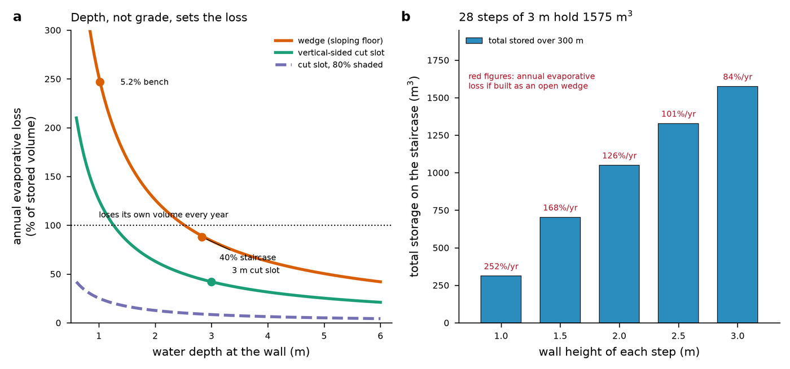
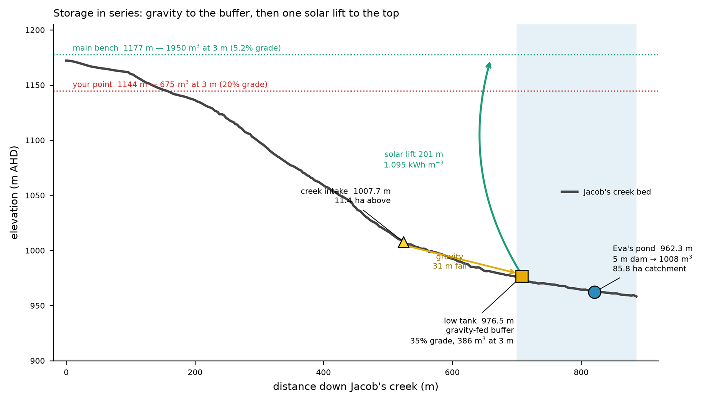
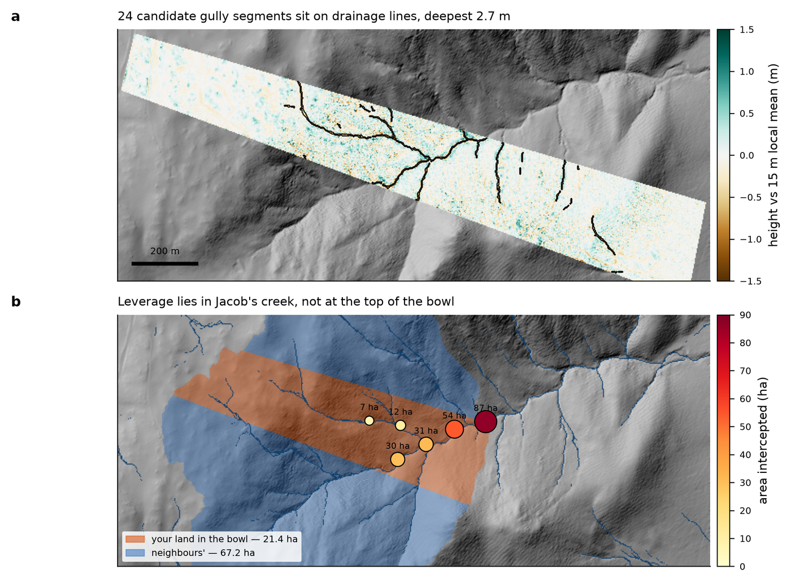

# pylandstore

**Where to keep water on sloping land, and what it costs to move it uphill.**

Catching water is the easy part. Keeping it is harder than most people expect,
because the same atmospheric demand that dries a paddock also empties a dam — and on
steep ground the shape a storage is forced into makes the difference between losing a
tenth of it a year and losing all of it.

This package handles the geometry and the energy: how deep a given volume sits on a
given grade, how much surface it is forced to expose, what that surface loses to
evaporation over a year, where along a channel a weir intercepts the most catchment,
and what it costs in lifting energy or solar panels to raise water to where it is
wanted.

It is the end of the chain, and it reuses the front of it: the evaporative demand
that drives the loss estimates is the same per-cell field computed in
[`pyterrainsol`](https://github.com/jborevitz/pyterrainsol), and the channel lines the
weir siting ranks come from
[`pychannelform`](https://github.com/jborevitz/pychannelform).

## Where this sits

Six small packages, one chain. Each does one thing and each is useful on its own.

| package | reads | gives you |
|---|---|---|
| [pylidarterrain](https://github.com/jborevitz/pylidarterrain) | classified airborne LiDAR | the ground surface a plant actually stands on: slope, aspect, how much sky it can see |
| [pyterrainsol](https://github.com/jborevitz/pyterrainsol) | that surface + daily weather | light and evaporative demand, cell by cell, day by day |
| [pyterrainwind](https://github.com/jborevitz/pyterrainwind) | that surface + reanalysis wind | wind exposure, and the extra demand it carries |
| [pychannelform](https://github.com/jborevitz/pychannelform) | that surface | where the water goes: catchments, channels, long profiles |
| **pylandstore** (this one) | channels + demand | **where to hold water, and what it costs to move it uphill** |
| [pylandgraze](https://github.com/jborevitz/pylandgraze) | all of the above + a herd | where the animals should be, hour by hour and season by season |

## Quickstart

```python
from pylandstore import (depth_for_volume, area_per_volume, flood_storage,
                         backwater_wedge, priestley_taylor_open_water,
                         annual_loss_fraction, lift_energy, solar_yield)
```

## What it found at 845 Avonside



*Left: annual evaporative loss against depth. **A 50 m³ wedge on 5% ground loses 247%
of its own volume per year** — it cannot hold water at all without refilling several
times over. The same volume on 40% ground is forced to 2.83 m deep and loses 88%; a
vertical-sided 3 m slot loses 42%, and shaded, **8%**. Right: total storage
achievable in 300 m of a 40% channel, annotated with open-wedge loss.*

The counter-intuitive result is that steep ground is *better* for storage, because it
forces depth. Shallow water on flat ground has nearly all of its volume within reach
of the atmosphere. Depth and shade are worth more than capacity: the thirty-fold
range above comes entirely from geometry, with no change in how much water went in.



*Storage sites in series. The intake at 1007.7 m gravity-feeds a buffer tank 31 m
below it; one solar lift of 201 m raises water to a bench at 1177 m. **Staging saves
no energy** — lift is ρgH regardless of how many steps it takes — but it buys a
still-water intake and lets a pump run continuously instead of chasing flow.*



*Candidate gully segments on drainage lines, and weir sites ranked by intercepted
area. **Leverage is in the main channel, not at the top of the catchment: three dams
at the head intercept 9% of the bowl between them.** The instinct to build small and
high is the expensive way to catch very little.*

## Methods

The conventions this package enforces, the traps it exists to prevent, and what it
deliberately does not do are in **[`docs/methods.md`](docs/methods.md)**.

Methods and results are kept apart on purpose. The methods travel to any site and
will be re-checked against new ground and simulated data; the findings above are one
46 ha property in the Snowy Monaro, some of them specific to it and some likely to
generalise. Either can then be argued with without disturbing the other.
