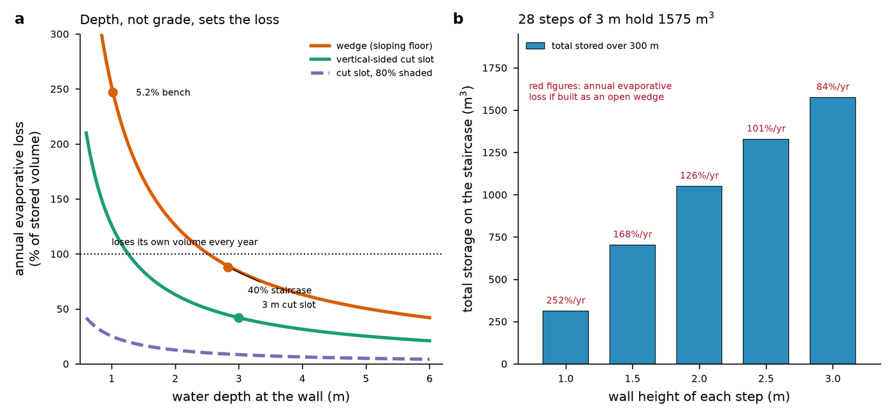
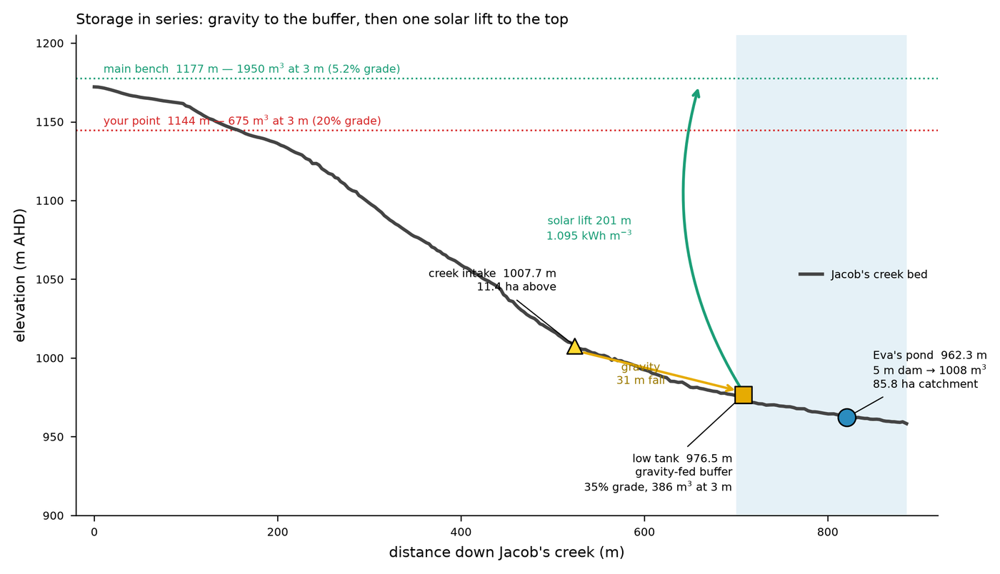
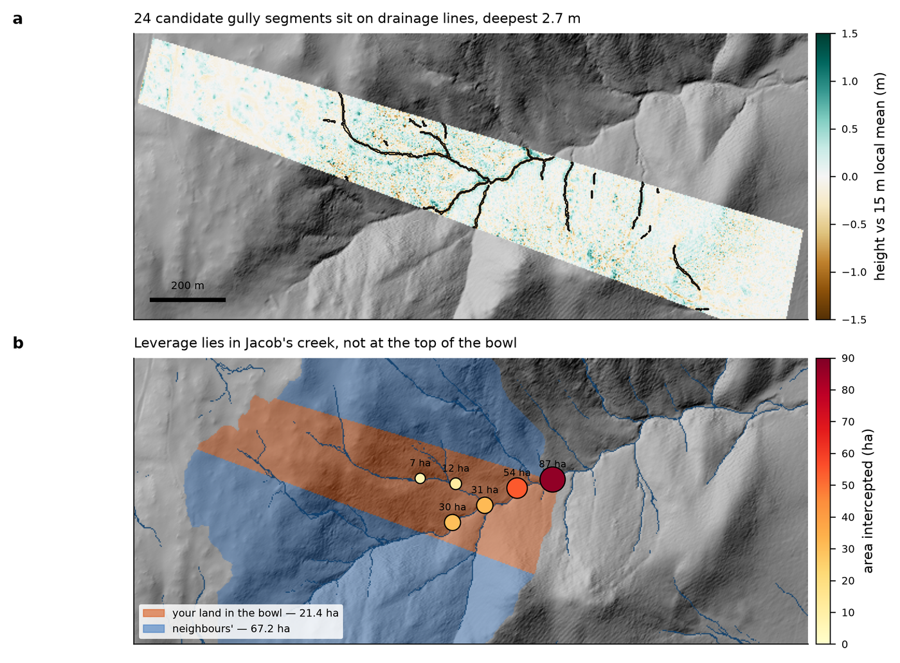

# pylandstore

Water storage geometry on sloping land: weirs, ponds, evaporation and pumping.

```python
from pylandstore import (depth_for_volume, area_per_volume, flood_storage,
                         backwater_wedge, priestley_taylor_open_water,
                         annual_loss_fraction, lift_energy, solar_yield)
```

## Three results worth knowing before you dig

**Surface area per cubic metre depends only on depth, not grade.** A wedge with a
sloping floor gives `A/V = 2/h`; a vertical-sided slot gives `1/h`. Evaporative loss
follows directly, so depth is the design variable and vertical sides are not a
refinement but the whole intervention.

**Grade still matters, because it fixes the depth you get.** 50 m³ in a 5 m width is
1.02 m deep on 5% ground and 2.83 m deep on 40% ground. Steep land therefore yields
deep, low-evaporation stores and gentle land yields shallow, lossy ones — the
opposite of the intuition that flat ground is better for water.

**Staging a pump up a hillside saves no energy.** Lift is ρgH whatever the number of
stages; extra stages only add losses. Stage for operational reasons — a still-water
intake, continuous running, a mid-slope offtake — not for efficiency.

## Two bugs this module exists to prevent

`flood_storage` **requires** a catchment mask. A dam impounds only its own catchment;
an unmasked flood-fill escapes down-valley. On a 47 ha farm the unmasked version
returned 57 million cubic metres.

`backwater_wedge` integrates the wedge along the surveyed bed instead of dividing by a
local grade. The division form hits zero grade on flat cells and produced both
zero-length backwaters and a 1250 m³ artefact.

## Evaporation numbers are modelled

`priestley_taylor_open_water` assumes `Rn = 0.60 Rs` and `Δ/(Δ+γ) = 0.55` near 10 °C.
Both are assumptions, not measurements. State them wherever the number is quoted.

## Worked example



*Left: annual evaporative loss against depth. A 50 m³ wedge on 5% ground loses 247% of
its own volume per year; the same volume on 40% ground is forced to 2.83 m deep and
loses 88%; a vertical-sided 3 m slot loses 42%, and shaded, 8%. Right: total storage
achievable in 300 m of a 40% channel, annotated with open-wedge loss.*



*Storage sites in series. The intake at 1007.7 m gravity-feeds a buffer tank 31 m
below it; one solar lift of 201 m raises water to a bench at 1177 m. Staging saves no
energy — lift is ρgH regardless — but it buys a still-water intake and continuous
pump running.*



*Candidate gully segments on drainage lines, and weir sites ranked by intercepted
area. Leverage is in the main channel, not at the top of the catchment: three dams at
the head intercept 9% of the bowl between them.*
